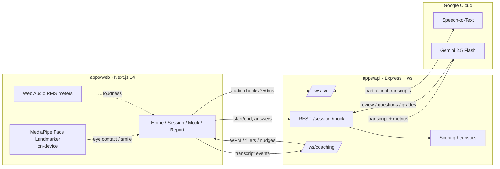

<div align="center">

# 🎙️ Echo

### Real-time AI speaking coach — live feedback while you speak, an AI coaching report when you finish.

[](https://nextjs.org/)
[](https://www.typescriptlang.org/)
[](https://nodejs.org/)
[](https://ai.google.dev/)
[](https://turbo.build/)
[](./LICENSE)

<em>Practice interviews, presentations and standups. Echo tracks your pace, fillers, eye contact and tone in real time, then turns your words into a personalized plan.</em>

</div>

---

> **Status:** Launch-ready **portfolio / local-first demo**. Core flows work end-to-end. Persistence is in-memory and there is no auth yet — see [Known limitations](#-known-limitations) and [`docs/ROADMAP.md`](./docs/ROADMAP.md).

## Overview

**Echo** is a real-time multimodal speaking coach. You speak into your mic and camera; Echo:

- transcribes your speech live,
- measures delivery signals (pace, filler words, loudness, eye contact, smile),
- nudges you gently while you talk, and
- generates an AI coaching report with strengths, fixes, English coaching, a STAR rewrite and a 7-day plan.

It also ships a **Mock Interview** mode where Gemini generates role-aware questions, grades each answer against a rubric, and gives an overall readiness signal.

### Why Echo exists

Most people get almost no objective feedback on _how_ they speak. Coaches are expensive and recordings are tedious to review. Echo gives instant, private, structured feedback so you can practice deliberately — and watch specific metrics improve over time.

---

## ✨ Core features

- **Live transcription** — streaming speech-to-text over WebSocket (Google Cloud Speech-to-Text).
- **Real-time coaching** — rolling WPM, filler-per-minute and gentle nudges via a dedicated WebSocket.
- **On-device vision** — eye contact + smile via MediaPipe face landmarks, computed in your browser.
- **Loudness & speaking time** — Web Audio RMS metering and a speaking-ratio estimate.
- **AI coaching report** — Gemini 2.5 Flash produces summary, strengths, issues, tone/English coaching, a STAR rewrite and a 7-day plan.
- **Mock Interview mode** — role-aware question generation, per-answer rubric, suggested better answers, and a hiring-readiness signal.
- **TTS narration** — listen to your report read aloud.
- **Polished dark UI** — responsive Next.js + Tailwind interface with thoughtful loading / empty / error states.

---

## 🧭 Product flows

### Live Coaching Session
1. Pick a scenario (Interview / Presentation / Standup) on the home page.
2. Echo starts a session and opens the live view.
3. Grant mic + camera. Audio streams for transcription; metrics update continuously.
4. End the session → metrics are scored and sent to Gemini → you land on a coaching report.

### Mock Interview Mode
1. Choose a role, difficulty and number of questions.
2. Gemini generates a tailored question set.
3. Answer each question with the same live meters as a session.
4. End → every answer is graded against a 5-dimension rubric → final report with a readiness signal.

---

## 🏗️ Architecture



### Monorepo structure

```
echo/
├── apps/
│   ├── api/                 # Express + WebSocket backend (port 8787)
│   │   └── src/
│   │       ├── index.ts     # server bootstrap + WS upgrade routing
│   │       ├── routes/      # session.ts, mock.ts (REST)
│   │       ├── ws/          # live.ts (STT stream), coaching.ts (metrics)
│   │       ├── services/    # gemini-review.ts, gemini-mock.ts, ...
│   │       └── db/          # in-memory models (Mongo-ready schema)
│   └── web/                 # Next.js 14 frontend (port 3000)
│       ├── app/             # home, session, mock, report, about/privacy/terms
│       └── components/      # shared UI (GradientButton, ScoreRing, ...)
├── packages/
│   └── core/                # shared, unit-tested utilities (wpm, fillers, scoring)
├── docs/                    # ARCHITECTURE, ENVIRONMENT, ROADMAP, LAUNCH_CHECKLIST
└── infra/                   # deployment notes (GCP, Atlas)
```

---

## 🧰 Tech stack

| Layer | Tech |
| --- | --- |
| Frontend | Next.js 14 (App Router), React 18, TypeScript, Tailwind CSS |
| Backend | Node.js, Express, `ws` (WebSocket) |
| Vision | MediaPipe Tasks Vision (face landmarks, in-browser) |
| Audio | Web Audio API (RMS metering), `MediaRecorder` (Opus/WebM) |
| AI | Google Cloud Speech-to-Text, Google Gemini 2.5 Flash |
| Tooling | Turborepo, npm workspaces, Prettier, `node:test` |

### AI services used
- **Google Cloud Speech-to-Text** — streaming transcription for live sessions.
- **Google Gemini 2.5 Flash** — coaching review, mock question generation, and answer grading (JSON mode with retry/backoff and graceful fallbacks).

---

## ⚡ Real-time pipeline

1. The browser records mic audio with `MediaRecorder` and ships ~250ms Opus/WebM chunks over `ws://…/ws/live`.
2. `apps/api/src/ws/live.ts` pipes those bytes into a Google streaming-recognize call and returns `partial` / `final` transcripts.
3. The UI forwards transcript events to `ws://…/ws/coaching`, which maintains a sliding window to compute rolling **WPM**, **filler rate**, simple tone heuristics and **nudges**.
4. MediaPipe runs **face landmarks** locally to estimate **eye contact** and **smile** — video never leaves the browser.
5. On end, the transcript + metrics are scored and sent to Gemini for the final report.

---

## 📊 Scoring methodology

Final report scores are 0–100:

- **Delivery** — distance of pace from a ~160 WPM target, adjusted for pauses.
- **Clarity** — penalized by filler-per-minute.
- **Presence** — weighted blend of eye contact (0.6) and smile (0.4).
- **Structure** — a transcript heuristic rewarding balanced length, coherent sentences, transitions, concrete examples and a clear opening. _(Falls back to a neutral baseline when no transcript is available.)_
- **Total** — `0.30·delivery + 0.25·clarity + 0.25·presence + 0.20·structure`.

The canonical, unit-tested implementation lives in [`packages/core/src/scoring.ts`](./packages/core/src/scoring.ts). Scores are directional coaching signals, not clinical measurements.

---

## 🚀 Getting started

### Prerequisites
- Node.js **≥ 18.17** (works on Node 24)
- A **Gemini API key** (for AI review + mock interviews) — [Google AI Studio](https://aistudio.google.com/)
- _Optional:_ **Google Cloud** service-account JSON with Speech-to-Text enabled (for live transcription)

### 1) Install
```bash
npm run install:all
```

### 2) Configure environment
```bash
cp apps/api/.env.example apps/api/.env        # add GEMINI_API_KEY (+ Google creds for live STT)
cp apps/web/.env.example apps/web/.env.local  # API + WebSocket URLs (defaults are localhost)
```
See [`docs/ENVIRONMENT.md`](./docs/ENVIRONMENT.md) for every variable.

### 3) Run locally
```bash
# one command (core build + api + web together)
npm run dev
```
…or run pieces in separate terminals:
```bash
npm run build:core      # build the shared package once
npm run dev:api         # http://localhost:8787
npm run dev:web         # http://localhost:3000
```

Open **http://localhost:3000** and start a session.

### Useful scripts
```bash
npm run typecheck   # typecheck core + api + web
npm test            # build core + run unit tests (node:test)
npm run build       # production build of all packages
npm run format      # Prettier
```

---

## 🔌 API overview

| Method | Endpoint | Purpose |
| --- | --- | --- |
| GET | `/healthz` | Health check |
| POST | `/session/start` | Start a coaching session |
| POST | `/session/end` | Score session + (optionally) generate Gemini review |
| GET | `/session/:id` | Session details |
| GET | `/session/:id/report/:rid` | A specific report (includes review if ready) |
| GET | `/session/:id/review` | Newest review (returns `{ pending: true }` while generating) |
| POST | `/mock/start` | Generate a mock question set |
| GET | `/mock/:id/next` | Next question |
| POST | `/mock/:id/answer` | Store an answer |
| POST | `/mock/:id/end` | Grade all answers + finalize report |
| GET | `/mock/:id/report?rid=…` | Mock report |
| GET | `/smoke/models`, `/smoke/gemini` | Gemini connectivity checks |

### WebSocket overview
- `ws://localhost:8787/ws/live` — send binary Opus/WebM audio; receive `{ type: "transcript", kind, text }` and `{ type: "state", … }`.
- `ws://localhost:8787/ws/coaching` — send `{ t, kind, text }`; receive `{ wpm, filler, tone, nudges }` frames.

---

## ⚠️ Known limitations

- **In-memory storage** — sessions/reports live in process memory and reset on API restart. A MongoDB schema is sketched but not wired.
- **No authentication** — built for local use and demos.
- **No committed screenshots yet** — the app is ready to run locally; a demo GIF or screenshots are a roadmap item.
- **Some duplicated logic** — `apps/api` keeps an in-sync copy of the scoring heuristic to stay self-contained at runtime; `@echo/core` is the canonical, tested version (consolidation tracked in the roadmap).
- **Permissive CORS** — the API currently allows all origins (fine for local dev; lock down before hosting).
- **Tests focus on core utilities** — route/WebSocket integration tests are future work.
- **Credentials required for full experience** — live transcription needs Google Cloud creds; review/mock need a Gemini key. The app degrades gracefully with clear messaging when they're missing.

---

## 🗺️ Roadmap

See [`docs/ROADMAP.md`](./docs/ROADMAP.md). Highlights: persistent storage (MongoDB Atlas), auth + session history, consolidating scoring on `@echo/core`, locked-down CORS, integration tests, and deployment to Cloud Run + Vercel.

---

## 🔒 Security & privacy

- **Video stays local.** Face tracking runs in-browser via MediaPipe; frames are never uploaded.
- **Audio is used for live analysis** during a session and streamed to Google Cloud for transcription; Echo does not persist raw audio.
- **Transcripts** are lightly redacted (obvious emails/phone numbers) before being sent to Gemini.
- **Secrets** live only in `apps/api/.env` (git-ignored). Never commit API keys or Google credential JSON files.

See [`/privacy`](http://localhost:3000/privacy) in the app and the [Launch checklist](./docs/LAUNCH_CHECKLIST.md).

---

## 👤 Author

**Echo** was built at **HackUMBC** and is maintained by
[Nithin Reddy Poola](https://nithinreddy.com/) as a portfolio project.

- Portfolio: [nithinreddy.com](https://nithinreddy.com/)
- Repository: [poolanithinreddy/echo-ai-speaking-coach](https://github.com/poolanithinreddy/echo-ai-speaking-coach)

---

## 📄 License

[MIT](./LICENSE) — free to use, modify and learn from.
