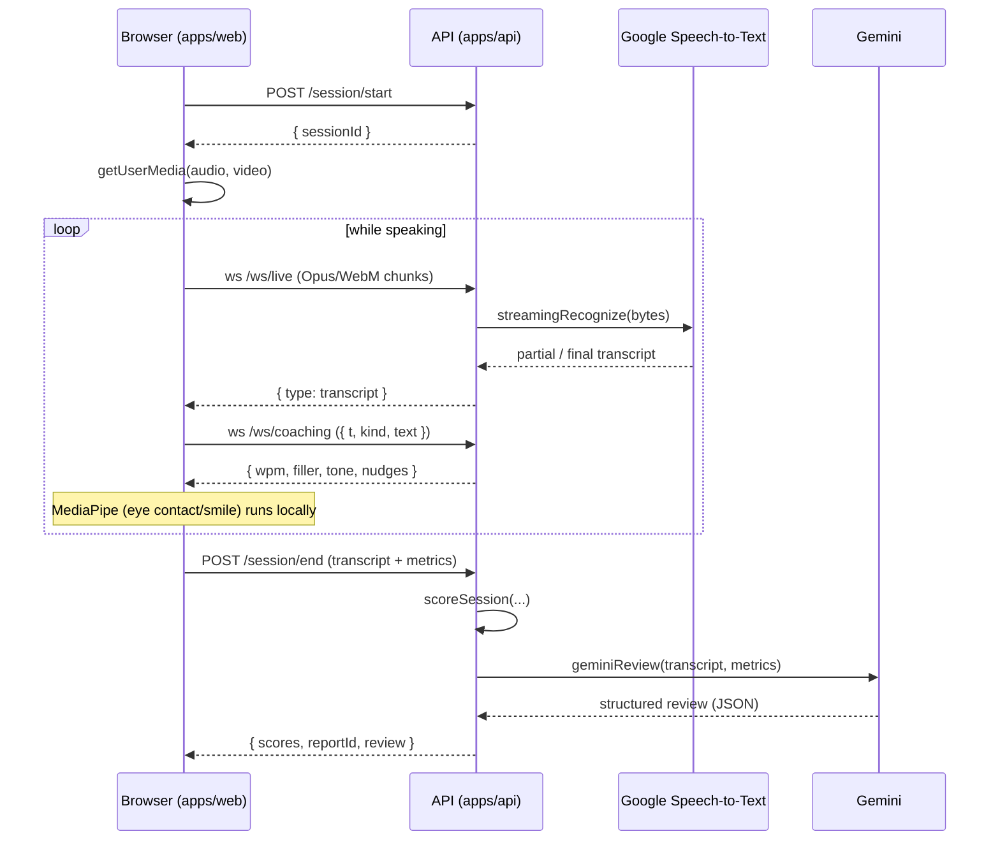

# Architecture

Echo is a Turborepo monorepo with two runnable apps and one shared package.

```
apps/web   →  Next.js 14 UI (port 3000)
apps/api   →  Express + WebSocket backend (port 8787)
packages/core → shared, unit-tested utilities (WPM, fillers, scoring)
```

## High-level data flow



## Backend (`apps/api`)

- **`src/index.ts`** — bootstraps Express, JSON logging, CORS, REST routers, and HTTP→WebSocket upgrade routing for `/ws/live` and `/ws/coaching`. Includes `uncaughtException` / `unhandledRejection` guards.
- **`src/ws/live.ts`** — validates Google credentials up front, opens a streaming-recognize bidi stream, buffers early audio, applies a heartbeat, and forwards transcripts. Fails soft with a `state` message if creds are missing.
- **`src/ws/coaching.ts`** — keeps a sliding window of transcript events, computes rolling WPM + filler rate, derives simple tone/energy heuristics, and emits compact, rate-limited nudges. Memory-capped.
- **`src/routes/session.ts`** — `start` / `end` / report retrieval. `end` sanitizes the transcript, computes scores (including the transcript-derived **structure** heuristic), returns the report immediately, and generates the Gemini review asynchronously.
- **`src/routes/mock.ts`** — mock lifecycle: generate questions (Gemini with a deterministic fallback), store answers, then grade all answers and finalize into a report.
- **`src/services/gemini-*.ts`** — Gemini callers in JSON mode with timeouts, exponential backoff, v1beta→v1 fallback, and response validation/repair.
- **`src/db/*`** — in-memory stores with a MongoDB-ready schema shape.

## Frontend (`apps/web`)

- **`app/layout.tsx`** — global shell: nav, footer, decorative background, SEO metadata, accessibility (skip link, live region), reduced-motion handling.
- **`app/page.tsx`** — marketing-grade home: hero, scenario picker, How-it-works, What-Echo-tracks, Mock mode, and tech/trust sections.
- **`app/session/[id]/page.tsx`** — the live "command center": camera preview, live meters (loudness, speaking %, words, eye contact, smile), transcript, nudges, dual WebSockets, MediaPipe, audio metering, reconnect with backoff.
- **`app/session/[id]/report/page.tsx`** — coaching report with score ring, metric cards, AI sections, quick tips, 7-day plan, TTS narration, polling for the async review, and export/share actions.
- **`app/mock/*`** — mock launcher, live interview, and graded report.
- **`components/`** — shared presentational primitives: `GradientButton`, `SectionCard`, `ScoreRing`, `MetricCard`, `ScenarioCard`, `Feature`, `Badge`, plus an inline `icons` set.

## Shared package (`packages/core`)

Pure, dependency-free utilities that are easy to unit-test (`node:test`):
`rollingWpm`, `detectFillers`, `structureScore`, `scoreSession`.

> The API currently keeps an in-sync copy of the scoring logic to remain fully
> self-contained at runtime (avoids `tsx` + ESM path-mapping edge cases).
> `@echo/core` is the canonical reference; consolidation is tracked in the roadmap.

## Real-time design notes

- Audio is chunked at **250ms** to balance latency and request overhead.
- The coaching socket is intentionally **separate** from transcription so metric
  computation never blocks the STT stream.
- Vision runs **on the client** to keep video private and reduce server load.
- Gemini calls **never block success**: sessions still return scores if the model
  is unavailable, and mock grading falls back to averaged content scores.
